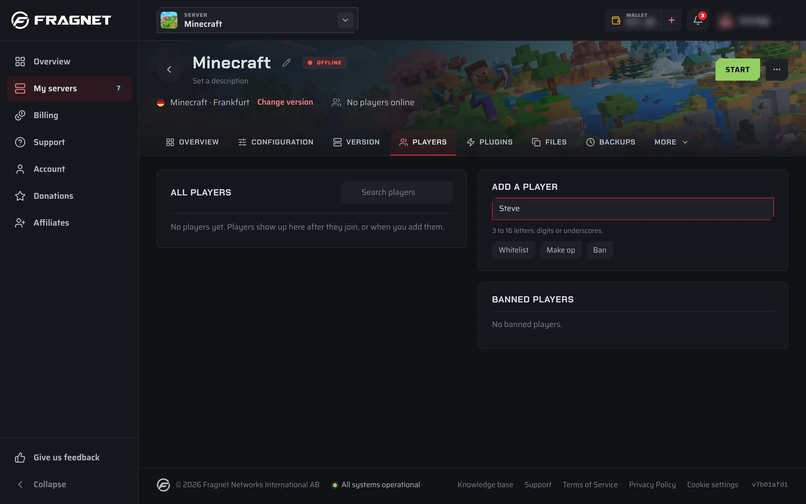

---
title: Becoming an admin (operator) on your Minecraft server 
keywords: ['minecraft server', 'minecraft add admin', 'minecraft add op', 'minecraft set admin', 'minecraft become admin', 'minecraft server add admin', 'minecraft server set admin', 'minecraft server become admin', 'minecraft', 'minecraft players tab', 'minecraft make op', 'minecraft ops.json', 'fragnet dashboard']
--- 

# Becoming an admin (operator) on your Minecraft server 

On Minecraft, an admin is called an operator (op). You can make a player an operator on the **Players** tab of the dashboard, with a console command, or in game if you're already an operator.

## Make a player an operator on the Players tab

1. Open the [Fragnet dashboard](VAR::PANEL_URL), go to **My servers** and select your server.
2. Select the **Players** tab. If you don't see it in the tab row, look under **More**.
3. In the **Add a player** card, type the player's Minecraft name in the **Minecraft name** field. Names are 3 to 16 letters, digits or underscores.
4. Select **Make op**. You see a confirmation that the player is now an operator.

Players who have already joined are listed under **All players**. Select **Make op** next to their name instead of typing it. Operators have an **Operator** tag.

To take operator rights away, select **De-op** next to the player.



:::info
- If the server is running, the change applies right away. If it's stopped, it's saved to `ops.json` and applies the next time the server starts.
- While the server is stopped, you can only add players who have joined the server before. Otherwise you see "That player hasn't joined this server yet. Start the server and try again."
:::

## Use a command

You can also use the **Console** card on the **Overview** tab (see [Send a command](../../control-panel/basics.md#send-a-command)). The server must be running. Run:

```
op yourUsername
```

To remove operator rights, run:

```
deop yourUsername
```

Operators can run the same commands in game, with a `/` in front: `/op yourUsername` and `/deop yourUsername`.

## Permission level

Each operator has a permission level from 1 to 4:

`1` - Player can bypass spawn protection.

`2` - Player can use commands such as `/summon, /teleport, /tp, /xp, /setblock, /locate, /kill, /give` and player can use command blocks.

`3` - Player can use commands related to multiplayer management such as `/ban, /deop, /kick, /op, /whitelist`.

`4` - Player can use all commands.

### Set the level for new operators

New operators get the level set in **Operator permission level** in `server.properties`. The default is `4`.

1. Select the **Configuration** tab and then `server.properties` in the list on the left.
2. In the **Players** group, change **Operator permission level**.
3. Select **Save and restart**, or **Save** to apply it at the next start. See [Change a setting](../../control-panel/configuration.md#in-a-game-config-file).

### Change the level of one operator

1. Stop the server, so it doesn't overwrite the file while you edit it.
2. Select the **Files** tab and open `ops.json` in the main folder (see [Edit a file](../../control-panel/file-manager.md#edit-a-file)). It looks like this:

   ```json
   [
     {
       "uuid": "1232378-342772-23432-82472-34237794724",
       "name": "yourUsername",
       "level": 4,
       "bypassesPlayerLimit": false
     }
   ]
   ```

3. Change the `level` of the player to a value from 1 to 4.
4. Select **Save file**, then start the server.
