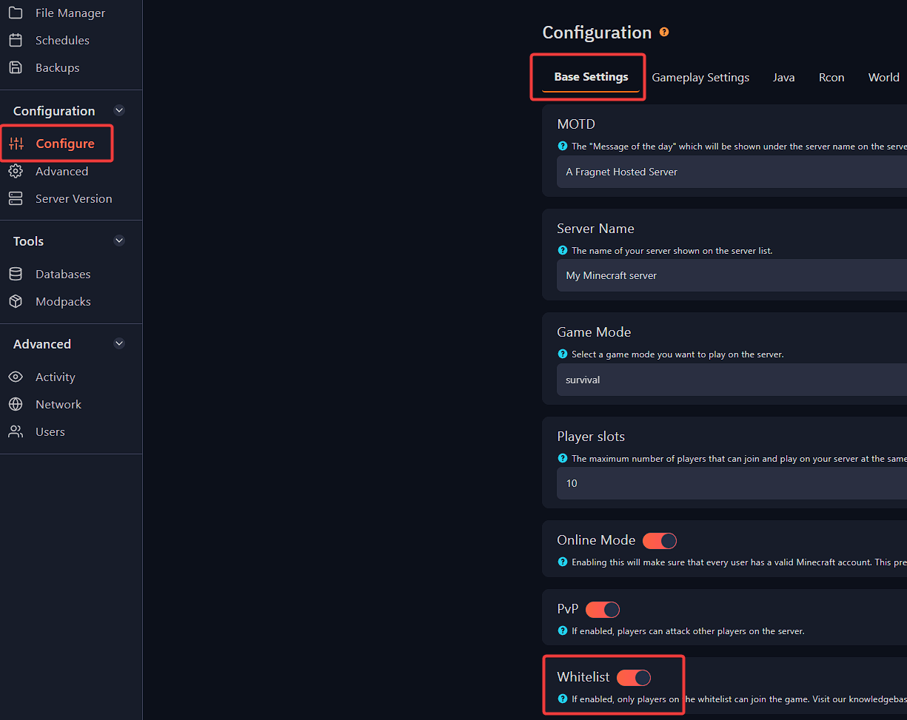
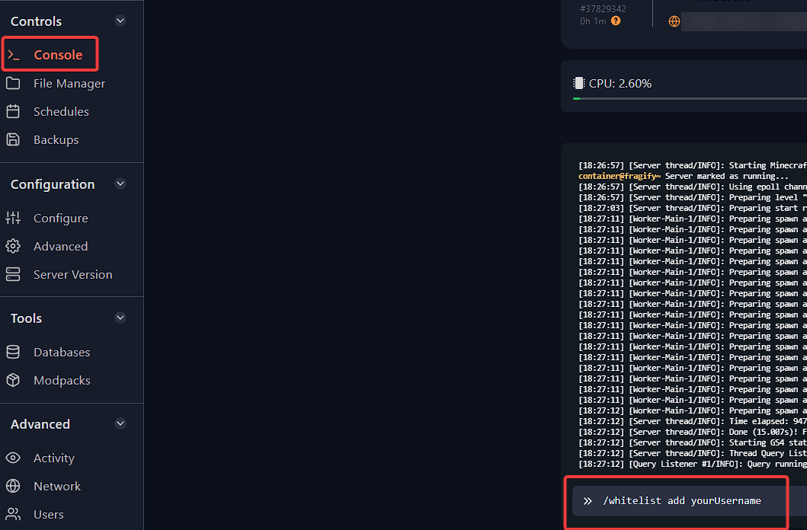

---
title: Creating whitelist on your Minecraft server
keywords: ['minecraft server', 'minecraft whitelist', 'minecraft server whitelist', 'minecraft', 'enable whitelist minecraft']
--- 

# Creating whitelist on your Minecraft server 

You can use whitelist function of your Minecraft server to allow only whitelisted players to join your server.

1. Login to [your Fragify panel account](VAR::PANEL_URL) and select your server. 

2. Navigate to **Configure** option on the left-side menu and look for **Whitelist** under `Base Settings`. You will need to enable it. 



3. Start the server. In the panel console, add a player with this command, replacing `yourUsername` with their Java username:

```text
whitelist add yourUsername
```

To run the same command in-game, use `/whitelist add yourUsername` as an operator. Console examples below omit the leading `/`; add it when running them in-game.

To remove a player:

```text
whitelist remove yourUsername
```



## Adding a group of Java players

Run one add command per player, checking the server's reply after each command. Then check the current list:

```text
whitelist add PlayerOne
whitelist add PlayerTwo
whitelist list
```

Replace the example names with the players' Java usernames. This keeps existing whitelist entries and avoids editing UUIDs or JSON by hand.

For a longer roster, you can use the optional [ServerBuddy whitelist command generator](https://serverbuddy.net/tools/minecraft-whitelist-command-generator) to remove duplicates and flag invalid name syntax. Review the names, copy only the `whitelist add` lines, and remove their leading `/` for the console. Syntax validation does not verify that an account exists; check the server's replies and the final list.

These examples are for Java Edition. Bedrock uses a separate `allowlist` command.
