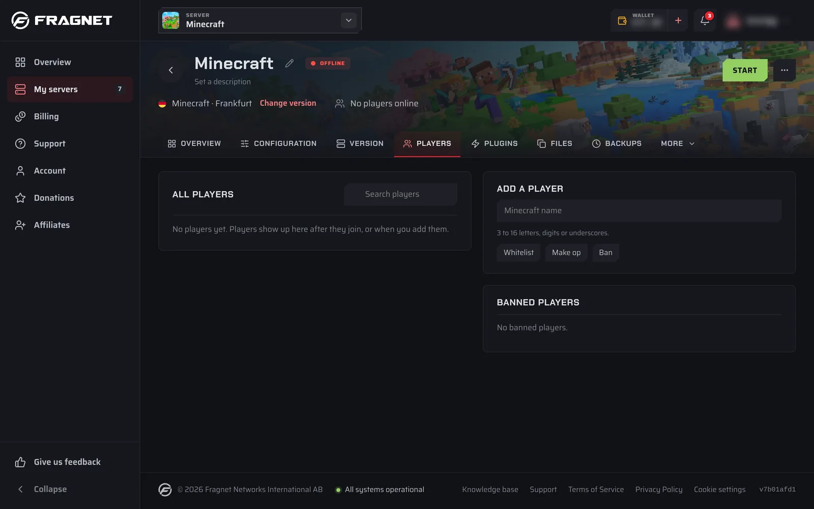

---
title: Creating whitelist on your Minecraft server
keywords: ['minecraft server', 'minecraft whitelist', 'minecraft server whitelist', 'minecraft', 'enable whitelist minecraft', 'minecraft players tab', 'minecraft white-list', 'fragnet dashboard']
--- 

# Creating whitelist on your Minecraft server 

With the whitelist turned on, only players on the list can join your server. You manage it on the **Players** tab of the dashboard.

## Turn on the whitelist

1. Open the [Fragnet dashboard](VAR::PANEL_URL), go to **My servers** and select your server.
2. Select the **Players** tab. If you don't see it in the tab row, look under **More**.
3. In the **Whitelist** card ("Only whitelisted players can join."), turn the switch on.

If the server is running, the whitelist turns on right away. If it's stopped, it turns on the next time the server starts.

You can also turn it on in `server.properties`: on the **Configuration** tab, select `server.properties`, and in the **Players** group turn on **Whitelist** (see [Change a setting](../../control-panel/configuration.md#in-a-game-config-file)). In the same group, **Enforce whitelist** kicks online players as soon as you remove them from the whitelist.

:::tip
If **Whitelist** in `server.properties` is tagged **Applied at start**, the value comes from your startup settings and is written into the file every time the server starts. Change it on the **Configuration** tab in that case, so it stays on after a restart. See [Easy editor and raw file](../../control-panel/configuration.md#easy-editor-and-raw-file).
:::

## Add players to the whitelist

1. On the **Players** tab, type the player's Minecraft name in the **Add a player** card.
2. Select **Whitelist**. You see a confirmation such as "Added Steve to the whitelist."

Players who have already joined are listed under **All players**. Select **Whitelist** next to their name instead. Whitelisted players have a **Whitelist** tag.

To take a player off the list, select **Remove from whitelist** next to their name.



:::info
While the server is stopped, you can only add players who have joined the server before. To whitelist someone new, start the server first.
:::

## Use commands

You can also manage the whitelist from the **Console** card on the **Overview** tab while the server is running (see [Send a command](../../control-panel/basics.md#send-a-command)), or in game as an operator with a `/` in front of the command.

Add a player:

```
whitelist add yourUsername
```

Remove a player:

```
whitelist remove yourUsername
```

Turn the whitelist on or off:

```
whitelist on
whitelist off
```
