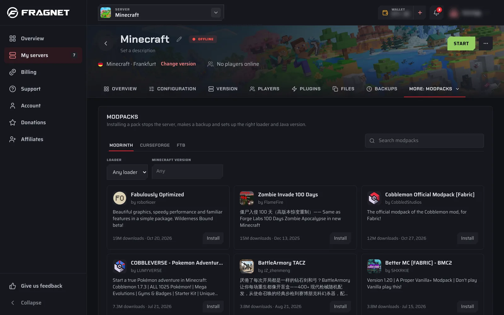
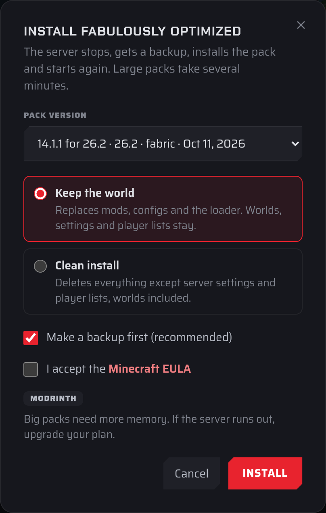

---
title: Adding modpack to your Minecraft server
keywords: ['minecraft server', 'minecraft add mod', 'minecraft add modpack', 'minecraft ftb', 'minecraft feed the beast', 'minecraft server add mod', 'minecraft server add modpack', 'minecraft modrinth', 'minecraft curseforge', 'minecraft modpacks tab', 'fragnet dashboard']
--- 

# Adding modpack to your Minecraft server

You can install modpacks from Modrinth, CurseForge and FTB (Feed The Beast) on the **Modpacks** tab of the dashboard. The install stops the server, makes a backup, sets up the right mod loader and Java version, and starts the server again.

:::tip
Make sure you and your players use the same modpack and version in your Minecraft launcher, or you can't join.
:::

## Install a modpack

1. Open the [Fragnet dashboard](VAR::PANEL_URL), go to **My servers** and select your server.
2. Select the **Modpacks** tab. If you don't see it in the tab row, look under **More**.
3. Choose where to search: **Modrinth**, **CurseForge** or **FTB**.
4. Type the pack's name in **Search modpacks**. To narrow the results, pick a **Loader** or type a **Minecraft version**. Select **Show more** at the bottom to see more packs.
5. Select **Install** on the pack you want.

   

6. In the install window, choose the **Pack version**. The newest release is picked for you.
7. Choose the **Install mode**:
   - **Keep the world**: "Replaces mods, configs and the loader. Worlds, settings and player lists stay."
   - **Clean install**: "Deletes everything except server settings and player lists, worlds included."
8. Leave **Make a backup first (recommended)** ticked. You need a free backup slot in your plan for it (see [Backups](../../control-panel/backups/index.md)).
9. Tick **I accept the Minecraft EULA**. The server doesn't start until the EULA is accepted.
10. Select **Install**.

    

A progress card at the top of the tab shows each step: stopping the server, making the backup, reading the pack, downloading and starting the server. You can leave the page while it runs. When it's done, you see "The modpack is installed and the server is starting." The installed pack then shows under **Current modpack**.

:::warning
A **Clean install** deletes your worlds. Keep the backup ticked if you might want them back.
:::

:::info
Big packs need more memory. If the server runs out of memory, upgrade your plan. See [Upgrade or downgrade your server](../../FAQ/upgrade-downgrade-server.md).
:::

## If the install fails

The progress card tells you why. If nothing was changed, the message says so. Otherwise it links to the backup made before the install, which you can restore on the **Backups** tab (see [Restoring a backup](../../control-panel/backups/restoring-a-backup.md)).

Some CurseForge packs contain mods whose authors only allow downloads through the CurseForge app. These packs can't be installed from the dashboard. Use one of the other ways below.

## Other ways to add a modpack

If the **Modpacks** tab says one-click modpacks are "coming to the dashboard soon", or you don't see the tab, you can still run a modpack:

- Download the pack's server files from the modpack's website and upload them on the **Files** tab or with an SFTP client. See [Files and SFTP](../../control-panel/file-manager.md).
- Or [open a support ticket](VAR::SUPPORT_URL) and ask us to install the pack for you.

To add single mods instead of a whole pack, use the **Plugins** tab: select **Browse plugins** and switch to **Mods**.
