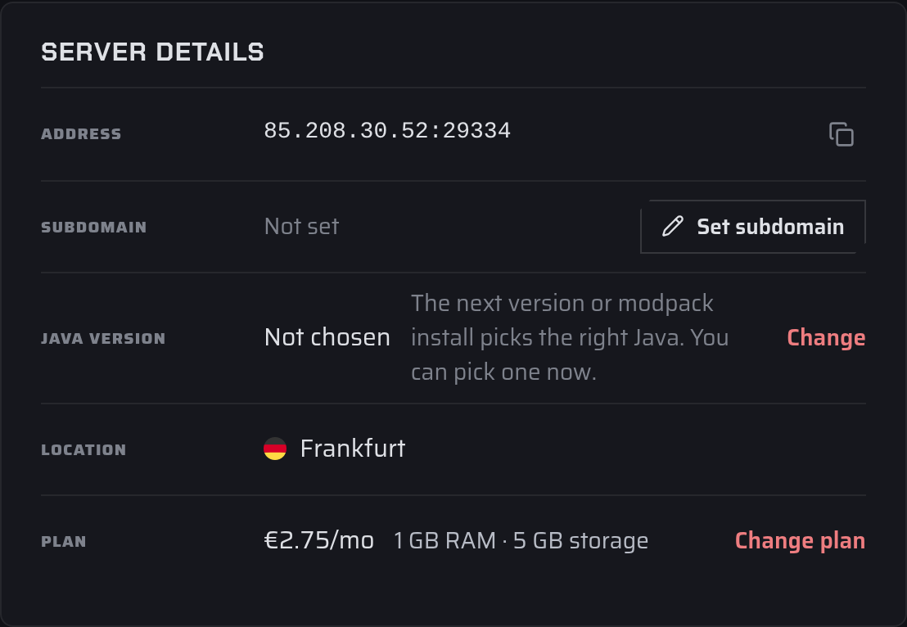
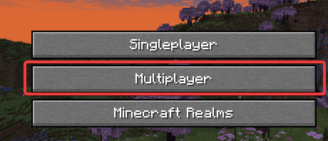
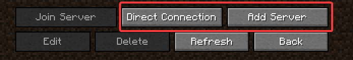
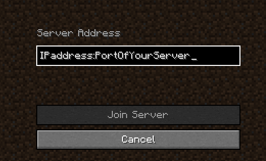
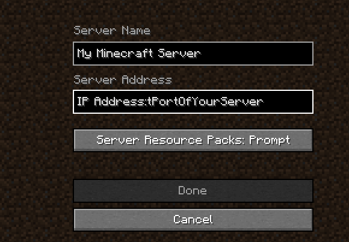

---
title: Connecting to your Minecraft server 
keywords: ['minecraft server', 'minecraft server', 'minecraft server connect', 'join minecraft server', 'minecraft', 'minecraft server address', 'minecraft server ip', 'minecraft subdomain', 'fragnet dashboard']
--- 

# Connecting to your Minecraft server 

You can join your server via Direct Connection or by Adding it in-game. 

:::info
Your Minecraft client must run the same version as your server. You can see the server's version at the top of its page in the dashboard, and change it on the **Version** tab. See [Switching server versions](./switch-server-version.md).
:::

## Find your server address

1. Open the [Fragnet dashboard](VAR::PANEL_URL), go to **My servers** and select your server.
2. On the **Overview** tab, find **Address** in the **Server Details** card. It shows your server's IP address and port, for example `203.0.113.10:25565`.
3. Select the copy button next to it to copy the address. If the server has both a domain and an IP address, use the **Domain** / **IP** switch to choose which one you copy. See [Server Details](../../control-panel/basics.md#server-details).

:::tip
Set a free subdomain, such as `myserver` on a Fragnet domain, so your players don't have to type an IP address and port. On Minecraft the subdomain works without a port. See [Subdomains](../../control-panel/subdomains.md).
:::

## Join the server in Minecraft

1. Make sure that your server is running and launch Minecraft. Select the **Multiplayer** option in the main menu.

2. You can select either **Direct Connection** or **Add Server** option. 

3. If you have selected **Direct Connection**, enter the address you copied from the dashboard and click on the **Join Server** button. 

If you have selected **Add Server**, enter a name for the server and the address you copied, then click on the **Done** button. Afterwards, you should see the server in the list, and you can click on it to connect. 

## Bedrock players

Players on Bedrock Edition (phones, tablets, Windows and consoles) can join a Java server once Bedrock crossplay is set up. You find the **Bedrock crossplay** card on the **Plugins** tab. It needs Paper, Purpur, Spigot, Fabric or NeoForge as the server software.
