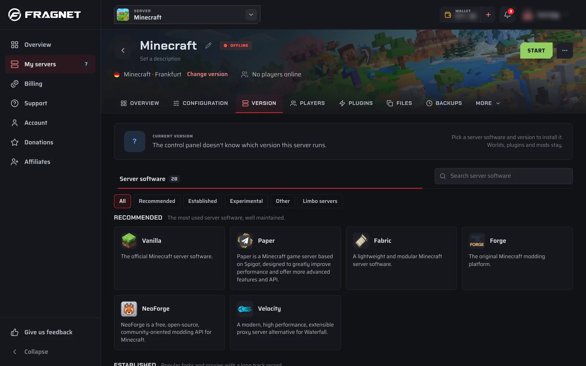
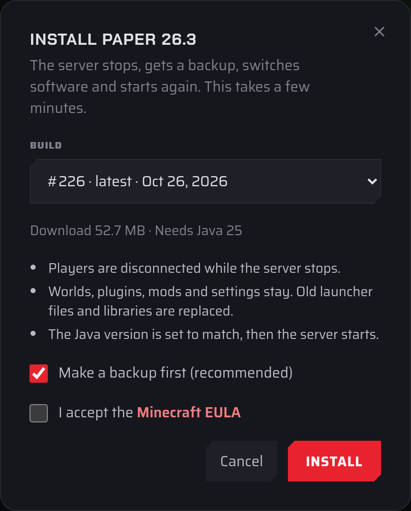

---
title: Switching server versions on your Minecraft server
keywords: ['minecraft server', 'minecraft server version switch', 'minecraft server change version', 'java version change minecraft', 'minecraft', 'minecraft server java version switch', 'minecraft paper', 'minecraft fabric', 'minecraft forge', 'minecraft version tab', 'fragnet dashboard']
--- 

# Switching server versions on your Minecraft server

On the **Version** tab of the dashboard you can switch to another server software (such as Vanilla, Paper, Fabric, Forge or NeoForge) and another Minecraft version. Your worlds, plugins, mods and settings stay. The dashboard also sets the Java version the new software needs.

## Install another version

1. Open the [Fragnet dashboard](VAR::PANEL_URL), go to **My servers** and select your server.
2. Select the **Version** tab, or **Change version** at the top of the server page. The **Current version** card shows what the server runs now, for example "Paper 1.21.4".
3. Under **Server software**, select the software you want. Use **Search server software** or the filters (**Recommended**, **Established**, **Experimental**, **Other**, **Limbo servers**) to find it. The software you run now has an **Installed** tag.

   

4. A list of Minecraft versions opens, newest first. Tick **Show snapshots** if you want test versions too.
5. Select **Install** next to the version you want. To reinstall the version you already run, select **Reinstall**.
6. In the install window:
   - Pick a **Build**. The latest one is picked for you.
   - Leave **Make a backup first (recommended)** ticked. You need a free backup slot in your plan for it (see [Backups](../../control-panel/backups/index.md)).
   - Tick **I accept the Minecraft EULA**. The server doesn't start until the EULA is accepted.
7. Select **Install**.

   

The server stops, gets a backup, switches software, sets the matching Java version and starts again. This takes a few minutes. A progress card at the top of the tab shows each step, and you can leave the page while it runs. When it's done, you see "The new software is installed and the server is starting."

:::warning Going back to an older version
If you pick an older Minecraft version of the software you already run, the dashboard warns you that opening a world in an older version can damage or reset it. Type the version number to confirm. Keep the backup in case you need to [restore it](../../control-panel/backups/restoring-a-backup.md).
:::

:::info Plugins and mods
Not every server software runs plugins or mods. If you switch, for example, from Paper to Vanilla or Fabric, the install window warns you. Your plugins or mods stay in their folders but don't load.
:::

## Java version

Each install sets the Java version the new software needs. You can also change it yourself in the **Java version** row of the **Server Details** card on the **Overview** tab: select **Change**, pick a version and confirm. It applies the next time the server starts. See [Server Details](../../control-panel/basics.md#server-details).

If the server doesn't start because it runs on the wrong Java, the console shows a button to switch to the right Java version and restart.

## New servers

A new Minecraft server shows a **Quick start** notice on the **Overview** tab. It asks what you want to run (a server software or a modpack), the version and a few basic settings, accepts the Minecraft EULA and starts the server. You can switch to other software later on the **Version** tab.

## If you can't install versions

If the **Version** tab only shows your current version with the note "Changing versions isn't available in the dashboard yet.", your server's setup doesn't support installs from the dashboard. [Open a support ticket](VAR::SUPPORT_URL) and tell us which software and version you want.
