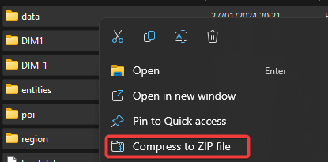
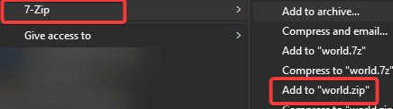

---
title: Uploading your local world to your Minecraft server
keywords: ['minecraft server', 'minecraft server world', 'minecraft world upload', 'load my world on minecraft server', 'minecraft', 'minecraft worlds tab', 'minecraft change world', 'minecraft level-name', 'fragnet dashboard']
--- 

# Uploading your local world to your Minecraft server

First of all, please ensure that your server runs the same modpack and version of Minecraft as your local world. Only Java Edition worlds can be uploaded. Bedrock worlds don't run on a Java server.

## Step 1: Compress your world

1. Open the folder where your world is located. Singleplayer worlds are in the `saves` folder of your Minecraft folder (on Windows, `%appdata%\.minecraft\saves`), one folder per world.
2. Open the world's folder. It usually contains `data`, `DIM1`, `DIM-1`, `region` and `level.dat`. Select all files with **CTRL+A** and right-click to see the menu. On Windows 11, select **Compress to ZIP file**.

Otherwise, you will need to have installed 7-Zip which can be installed from [here](https://7-zip.org/download.html) and use 7-Zip to add files to zip archive. 

## Step 2: Upload the world on the Worlds tab

1. Open the [Fragnet dashboard](VAR::PANEL_URL), go to **My servers** and select your server.
2. Select the **Worlds** tab. If you don't see it in the tab row, look under **More**.
3. Select **Upload world** and choose your ZIP file.
4. In the **Upload a world** window, check the **World name**. It becomes the folder name on the server. Use letters, numbers, `-` and `_` only, up to 64 characters, and pick a name no other world on the server has.
5. Select **Upload world**. A progress bar shows the upload.

The dashboard then unpacks the world. It's added as a new world; your current world doesn't change. When it's done, you see "The world is in place. Make it active to play on it."

<!-- screenshot: minecraft-worlds-tab.png | Minecraft server, Worlds tab: the Worlds card with the "Active world: … · Seed: …" line and the Upload world button, a list of two worlds where one has the Active tag and the other shows Make active, Download, Reset and Delete -->

:::info
- The ZIP can be up to 4 GB. For a bigger world, upload the world folder with an SFTP client instead (see [Other ways to upload a world](#other-ways-to-upload-a-world)).
- The ZIP must contain the world's `level.dat`. It doesn't matter whether you zipped the world folder itself or the files inside it.
:::

## Step 3: Make the world active

1. In the list on the **Worlds** tab, select **Make active** next to your uploaded world.
2. Restart the server, or start it if it's stopped (see [Power controls](../../control-panel/basics.md#power-controls)). If everything was set up correctly (same version and same modpacks), the server loads your world.

Your previous world stays on the server. To switch back, select **Make active** next to it and restart. To remove a world you no longer need, select **Delete** next to it. You can't delete the active world.

The **Worlds** tab also lets you **Download** a world, and **Reset** one, which deletes it so the server makes a new world on the next start, with the same or a new seed.

## Other ways to upload a world

If you don't see the **Worlds** tab, or your world is larger than 4 GB, upload the world as a folder and point the server to it:

1. Stop the server.
2. Upload your world into a new folder in the server's main folder:
   - On the **Files** tab: select **New folder** and give it a name, for example `myworld`. Open the folder, **Upload** your ZIP into it and use **Extract** on the ZIP. Then delete the ZIP. See [Files and SFTP](../../control-panel/file-manager.md#upload-files).
   - Or with an SFTP client: upload your world folder into the main folder. See [SFTP and FTP access](../../control-panel/file-manager.md#sftp-and-ftp-access).
3. Make sure `level.dat` is directly inside the new folder, not in a folder below it.
4. Select the **Configuration** tab, then `server.properties`. In the **World** group, set **World folder** to the name of the new folder, for example `myworld`. See [Change a setting](../../control-panel/configuration.md#in-a-game-config-file).
5. Select **Save and restart**, or **Save** and start the server.

:::tip
Make a [backup](../../control-panel/backups/index.md) before you replace or delete a world. Deleted worlds can't be recovered without one.
:::
