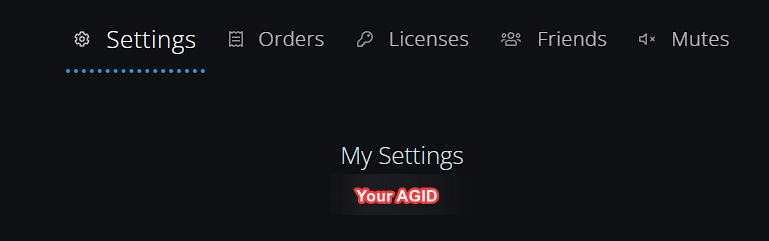

# Adding admins on your Path Of Titans server

To make a player an admin, you need their Alderon Games ID (AGID). You add it on the **Access** tab of your server in the dashboard.

## Find your Alderon Games ID (AGID)

Every player has an Alderon Games ID that looks like `123-456-789`.

- **On the Alderon Games website**: sign in at https://alderongames.com/login and open https://alderongames.com/me/settings. Your AGID is under **My Settings**.



- **In the Alderon Games Launcher**: your AGID is at the top right.


## Add an admin

1. Open the [Fragnet dashboard](VAR::PANEL_URL), go to **My servers** and select your Path of Titans server.
2. Stop the server (see [Power controls](../../control-panel/basics.md#power-controls)). The admin list is saved in `Game.ini`, which the server can rewrite while it runs, so the list can only be changed while the server is stopped.
3. Select the **Access** tab, then **Admins**. If you don't see the **Access** tab, look under **More**.
4. In **Alderon IDs (one or more)**, enter the player's AGID. To add several admins at once, separate the IDs with spaces or commas.
5. Select **Add**. The dashboard shows "Saved."
6. Start the server. Admins get their rights the next time the server starts.

<!-- screenshot: pot-access-admins.png | Path of Titans server, Access tab with the Admins list selected (Admins / Whitelist / Bans switch visible), server stopped, the "Alderon IDs (one or more)" field with Add button and at least one AGID in the list with its copy and bin buttons; include the "Find an Alderon ID" card below -->

To remove an admin, stop the server, select the bin icon next to their ID on **Access** > **Admins**, then start the server again.

Once you are an admin, you can use the [admin chat commands](admin-chat-commands.md) in game. Path of Titans doesn't read commands typed in the dashboard console (see [Games without a full console](../../control-panel/basics.md#games-without-a-full-console)).

## Where the admin list is stored

The dashboard writes each admin as a `ServerAdmins=` line under `[/Script/PathOfTitans.IGameSession]` in `PathOfTitans/Saved/Config/LinuxServer/Game.ini`. You can also edit these lines yourself on the **Files** tab while the server is stopped (see [Edit a file](../../control-panel/file-manager.md#edit-a-file)). Add one player per line. To remove an admin, delete their line.

### Example of Game.ini

```ini
[/Script/PathOfTitans.IGameSession]
ServerAdmins=087-234-324
ServerAdmins=348-892-843
ServerAdmins=249-453-328
;comments start with a semicolon
```

To give players only some admin commands, create a player role instead. See [Create and modify player roles](add-player-role.md).
