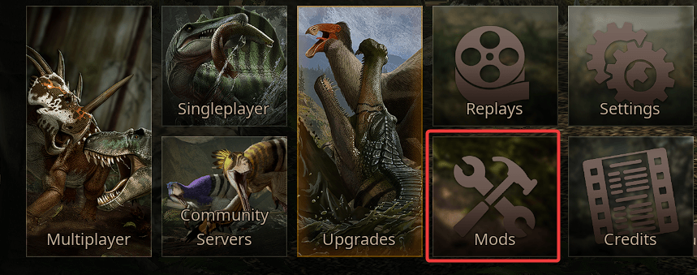
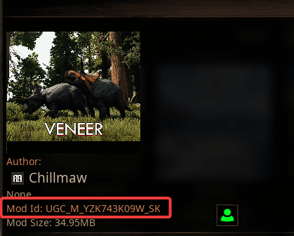

# Setting up Mods on your Path Of Titans server

You manage your server's mods on the **Mods** tab of the dashboard. The server downloads the mods when it starts, and players get them automatically when they join. If you use a modded map, you also set its map name as the server's map.

## Find a mod's ID

Open the mod browser in the game: select **Mods** in the main menu, select the mod you want and note its **Mod Id**. Mod IDs look like `UGC_M_YZK743K09W_SK`.




## Add mods to your server

1. Open the [Fragnet dashboard](VAR::PANEL_URL), go to **My servers** and select your Path of Titans server.
2. Stop the server (see [Power controls](../../control-panel/basics.md#power-controls)). The mod list is saved in `GameUserSettings.ini`, which the server can rewrite while it runs, so you can only change mods while it's stopped.
3. Select the **Mods** tab. If you don't see it, look under **More**.
4. In **Mod ID or link**, paste the mod ID. You can also paste text or a link that contains the ID.
5. Optionally, enter a **Name (optional)** so you know which mod it is.
6. Select **Add mod**. Repeat for each mod you want.
7. The server loads the mods in the order shown. Use the up and down arrows to change the order, or the bin icon to remove a mod.
8. Select **Save mods** in the bar that says "The mod list has unsaved changes." (**Discard** throws your changes away.)
9. Start the server. The mods download when it starts.

<!-- screenshot: pot-mods-tab.png | Path of Titans server, Mods tab, server stopped: the "Mod ID or link" and "Name (optional)" fields with Add mod, a list of two or three mods with names, IDs and arrow/bin buttons, the unsaved-changes bar with Save mods, and the "About mods" card -->

:::tip
Some mods block mobile players. Check a mod's page before you add it.
:::

## Use a modded map

A map mod also needs its map name set as the server's map. Only one map can run at a time.

1. Add the map mod on the **Mods** tab as described above, and save.
2. Open the **Configuration** tab, select **General**, then the **World** group. You can also use the **Choose the map** link in the **About mods** card on the **Mods** tab.
3. Under **Map**, select **Map mod…**.
4. Enter the map name exactly as the mod gives it, for example `TheGrimExpanse`. Generally this is the same as the mod's name, but check with the mod author to be sure. Names can contain letters, digits, `_` and `-`.
5. Select **Save** in the bar at the bottom, then restart the server (see [Under General](../../control-panel/configuration.md#under-general)).

Set the map here rather than with `ServerMap` in `Game.ini`. The server starts with the map from this setting.

If everything is set up correctly, your mods load after the restart. In the game's community server browser, select **Details** on your server to see the mods it runs.

## Edit GameUserSettings.ini yourself

The **Mods** tab writes each mod as an `EnabledMods` line under `[PathOfTitans.Mods]` in `PathOfTitans/Saved/Config/LinuxServer/GameUserSettings.ini`, with the name you entered as a comment above it. You can also edit this file while the server is stopped, on the **Configuration** tab (select `GameUserSettings.ini`) or on the **Files** tab. Example with several mods:

```ini
[PathOfTitans.Mods]
;TheGrimExpanse
EnabledMods="UGC_M_DYV7XYEGX2_SK"
;German Shepard Mod (an example of mod stacking)
EnabledMods="UGC_M_DYV0XMY7GX_SK"
EnabledMods="UGC_M_YZK743K09W_SK"
```
