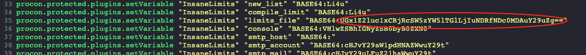
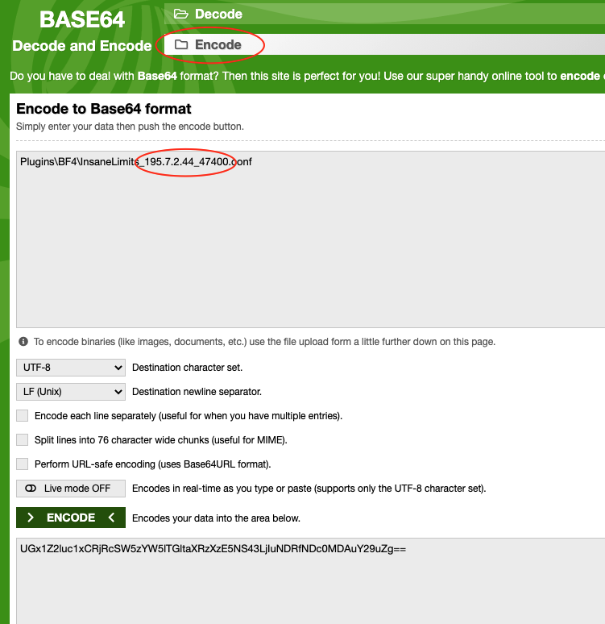

# Troubleshooting InsaneLimits reset on restart

On rare occasions, if you are running the InsaneLimits plugin on your Procon Layer, its rules reset when the layer restarts. This happens if you have multiple InsaneLimits config files, especially if the Procon Layer or your Battlefield server was moved from one IP to another.

You fix it in the layer's files on the **PRoCon** tab in the [Fragnet dashboard](VAR::PANEL_URL). You need your Battlefield server's IP and RCON port: find them on the **Overview** tab, in the **Connection** card (**Game address** and **RCON port**).

## Stop the layer and open its files

Procon rewrites its configs when it stops, so stop the layer before you change anything.

1. Open the [Fragnet dashboard](VAR::PANEL_URL), go to **My servers**, select your Battlefield server and open the **PRoCon** tab. If it's not in the tab row, look under **More**.
2. Select **Stop** and wait until the status is **Offline**.
3. Below the cards, select **Files**. You see the layer's **Plugins**, **Configs** and **Logs** folders.

<!-- screenshot: procon-tab-files-configs.png | BF4 server, PRoCon tab with the layer Offline, Files section open in the Configs folder: the Layer / Configs breadcrumb and the folder named after the server's IP and port in the list -->

## Check the limits file setting

1. Open `Configs/IP_Port/InsaneLimits.cfg`, where `IP_Port` is the folder named after your Battlefield server's IP and RCON port.
2. Look for the following line:

   `procon.protected.plugins.setVariable "InsaneLimits" "limits_file"`

   The line continues with a BASE64 encoded string.
3. Copy the text after `BASE64:` and paste it on [Base64decode](https://www.base64decode.org/) to decode it.

When it's decoded, check whether the IP\_PORT in the output (the IP of the Battlefield server and its RCON port) is wrong. If it's right, this guide doesn't apply.

## Fix the limits file

1. Select **Layer** in the path at the top to go back, then open the **Plugins** folder and the `BF4` folder (`BF3` for a Battlefield 3 server). You should see 2 InsaneLimits config files: one for the old IP and one for the new IP. The new file should be 0 KB.
2. Open the old file, select all its text and copy it. Select the back arrow (**Back to files**).
3. Open the new file, paste the text and select **Save**.
4. On [Base64decode](https://www.base64decode.org/), switch to the **Encode** tab. Enter the following line with your own Battlefield server IP and RCON port, and press **ENCODE**:

   `Plugins\BF4\InsaneLimits_IP_RCONPORT.conf`

   Use `BF3` instead of `BF4` for a Battlefield 3 server.

   

5. Go back to `Configs/IP_Port/InsaneLimits.cfg`, replace the old BASE64 string with the one you just generated and select **Save**.
6. Select **Start** at the top of the **PRoCon** tab.

The limits you set should no longer reset.
