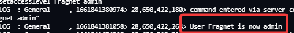
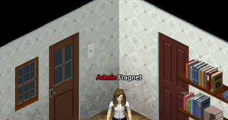
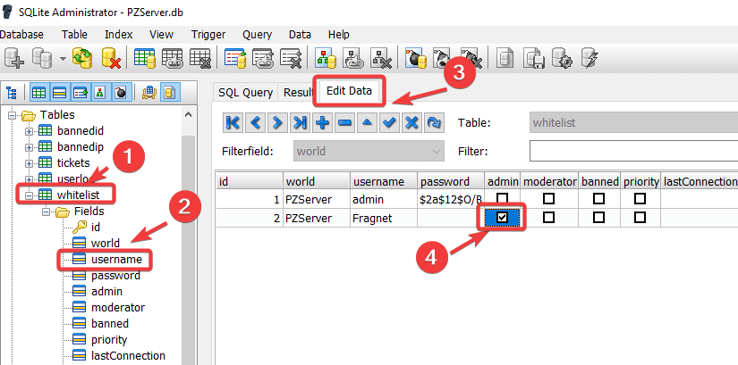

# Adding admins to your Project Zomboid server

There are two ways to make a player an admin: with a command in the server console, or by editing the server's player database.

## Option 1: Use the server console

1. Join your server with the player you want to make an admin, so their account exists on the server.
2. Open the [Fragnet dashboard](VAR::PANEL_URL), go to **My servers** and select your Project Zomboid server.
3. On the **Overview** tab, click in the **Enter a command…** field at the bottom of the **Console** card (see [Send a command](../../control-panel/basics.md#send-a-command)).
4. Type the following command, with the player's username, and press **Enter**:

   ```text
   setaccesslevel usernameOfPlayer admin
   ```

   If the username has spaces, put it in quotes: `setaccesslevel "user name" admin`.

The console confirms the change:



In the game, the player now has a red **Admin** tag next to their username.



To see the other console commands, type `help`.

### Access levels

Instead of `admin`, you can give a player one of these access levels.

**Observer**

- Toggle god mode (on themselves only)
- Toggle invisible (on themselves only)
- See connected players (`/players`)
- Teleport to a player (can't teleport a player elsewhere)
- Toggle noclip (on themselves only)
- Teleport to coordinates
- See server options
- Open locked doors
- Go inside safehouses
- Can't be kicked for lag
- Can always join the server, even if it's full
- Can talk while invisible
- Sees invisible players
- Can't be hit by players
- Logs in invisible and invincible
- See player stats (name, skills, traits and more) by clicking a player and selecting **Check Stats**, but can't change them

**GM**

- Everything an Observer can do, plus:
- Toggle god mode (on themselves and others)
- Toggle invisible (on themselves and others)
- Toggle noclip (on themselves and others)
- Teleport a player to another player
- Use `/alarm`, `/gunshot`, `/thunder` and `/chopper`
- Start and stop rain
- Add items
- Add XP

**Overseer**

- Everything a GM can do, plus:
- Create a horde
- Kick users
- Display a server message
- See a player's connection info
- Disconnect a player by connection number (`/disconnect`)
- Use `/nightlengthmodifier`
- Change player stats in the player stats window
- Ban a player from `/all` chat

**Moderator**

- Everything an Overseer can do, plus:
- Ban and unban users (including by Steam ID)
- Manage the whitelist (`/adduser`, `/addusertowhitelist`, `/addalltowhitelist`, `/removeuserfromwhitelist`)
- Change access levels (but can't set admin)
- Set up safehouses

**Admin**

- Everything a Moderator can do, plus:
- Save the world
- Quit the world
- Change access levels (including admin)
- Reload server options
- Change server options
- Send a pulse
- Reload Lua files
- Bypass the Lua checksum

## Option 2: Edit the PZServer.db database

The server keeps its player accounts in a database file, `PZServer.db`, in the `pzserver/db` folder. This is a binary file, so you download it, edit it on your computer and upload it again.

1. Open the [Fragnet dashboard](VAR::PANEL_URL), go to **My servers** and select your Project Zomboid server.
2. Stop the server with **Shut down**. The server writes to the database while it runs.
3. Open the **Files** tab and go to the `pzserver/db` folder.
4. Open the ⋯ menu of `PZServer.db` and select **Download**.
5. Download [SQLite Admin](http://sqliteadmin.orbmu2k.de/), a program for editing SQLite database files, and open `PZServer.db` with it.
6. Under **Tables**, select **whitelist**, expand it and select a field, for example **id**.
7. Open the **Edit Data** tab. Tick the **admin** box next to each player who should be an admin.

   

8. Close the database. Your changes are saved automatically.
9. In the dashboard, go back to the `pzserver/db` folder in the **Files** tab and upload the edited `PZServer.db` with **Upload**, or drag it onto the file list. It replaces the file on the server. See [Upload files](../../control-panel/file-manager.md#upload-files).
10. Start the server with **Start**. The players now have admin rights.

:::info
The database is named after the **Server Config Name** startup setting, which is `PZServer` by default. If you changed that setting, look for the file with your name instead.
:::
