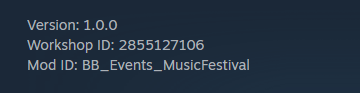
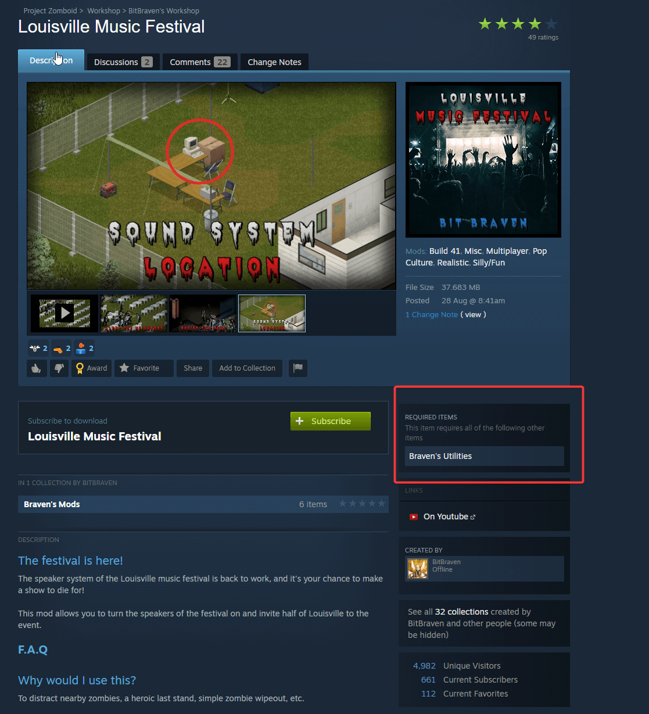

# Adding and enabling mods on your Project Zomboid server

Your Project Zomboid server downloads Steam Workshop mods when it starts. You tell it which mods to load with two startup settings in the dashboard.

## Find the mod IDs

1. Go to the [Project Zomboid Steam Workshop](https://steamcommunity.com/app/108600/workshop) and find the mods you want to play with.
2. On each mod's page, look for the **Workshop ID** and the **Mod ID**. They are usually at the bottom of the description. You need both.

   

3. Some mods need other mods to work. These are listed under **Required items** on the mod's page. Add the required mods as well.

   

## Add the mods to your server

1. Open the [Fragnet dashboard](VAR::PANEL_URL), go to **My servers** and select your Project Zomboid server.
2. Open the **Configuration** tab and select **General** in the list on the left.
3. In the **Startup** group, find **Mod Workshop ID's** and enter the **Workshop ID** of the mod.
4. Find **Mod Names** and enter the **Mod ID** of the mod.
5. For several mods, separate the IDs with a semicolon (`;`), without spaces. For example:
   - **Mod Workshop ID's**: `2975204120;2985394645`
   - **Mod Names**: `NepEngineColor;TakeAnyAmount`
6. Select **Save** in the bar at the bottom of the page.
7. Start or restart the server. To restart, open ⋯ **More actions** at the top of the page and select **Restart**. The server downloads and loads the mods while it starts.

See [Change a setting under General](../../control-panel/configuration.md#under-general) for more on saving these settings.

:::tip
A mod only loads when it's in both settings: its Workshop ID in **Mod Workshop ID's** and its Mod ID in **Mod Names**. The order doesn't matter. Mod IDs are case-sensitive, so copy them exactly.
:::
