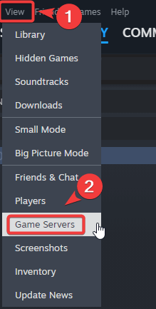
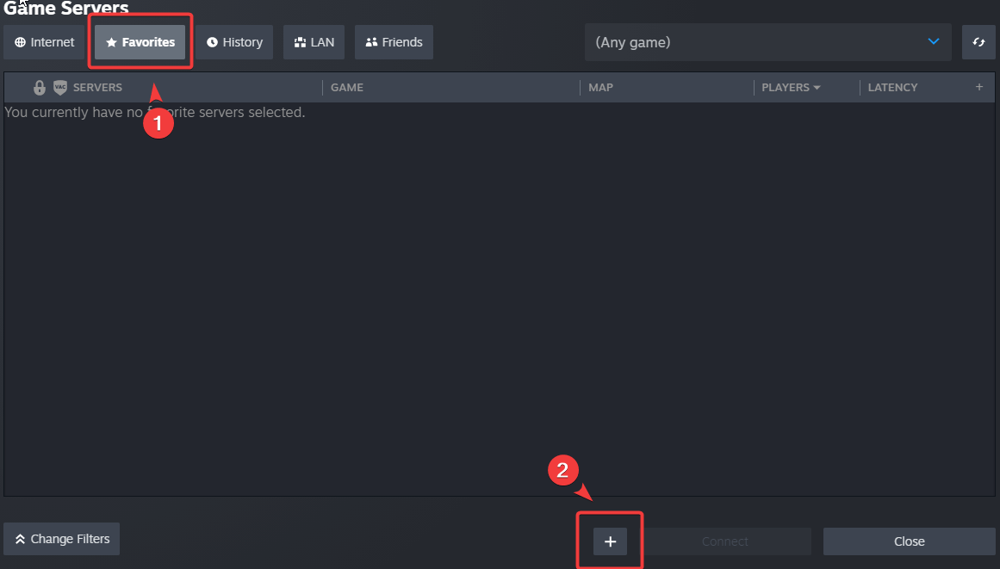
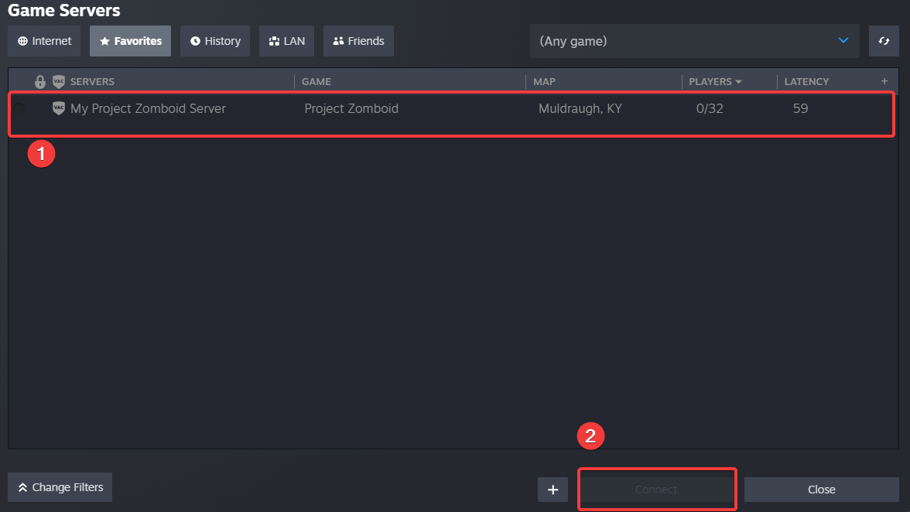
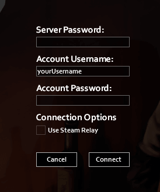
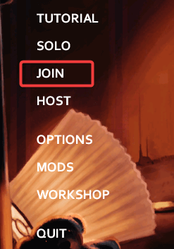
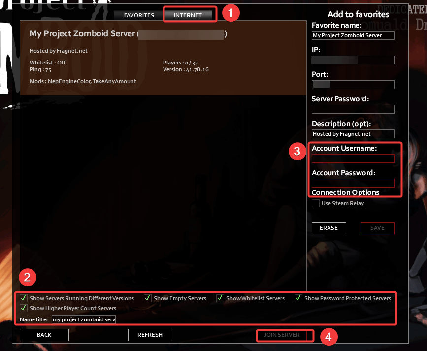

# Finding and connecting to your Project Zomboid server

You can connect to your Project Zomboid server through Steam's server list, or through the in-game server browser.

## Find your server's address

1. Open the [Fragnet dashboard](VAR::PANEL_URL), go to **My servers** and select your Project Zomboid server.
2. On the **Overview** tab, the **Server Details** card shows the **Address**. Select the copy button next to it.

The address has two parts, the host and the port, separated by a colon (`host:port`). See [Server Details](../../control-panel/basics.md#server-details).

## Via Steam

1. Open Steam and go to **View** > **Game Servers**.

   

2. Open the **Favorites** tab and select the **+** button to add a server.

   

3. Enter your server's address (host and port) and select **OK**.
4. Your server appears in the list. Select it, then select **Connect**.

   

5. When the game has started, it asks for your login details. Enter the username and password you want to use on this server, then select **Connect**.

   

## Via the in-game server browser

1. Launch the game and select **Join** in the main menu.

   

2. Open the **Internet** tab. In **Name filter**, enter your server's name and make sure all the filter boxes are ticked. The name is the **Server Name** startup setting, on the **Configuration** tab under **General**.
3. Select your server. Enter your **Account Username** and **Account Password**, then select **Join Server**.

   

:::tip Can't find your server?
Check that the name you search for matches the **Server Name** startup setting, or add the server with its address on the right of the browser. Make sure you use the right host and port.
:::
