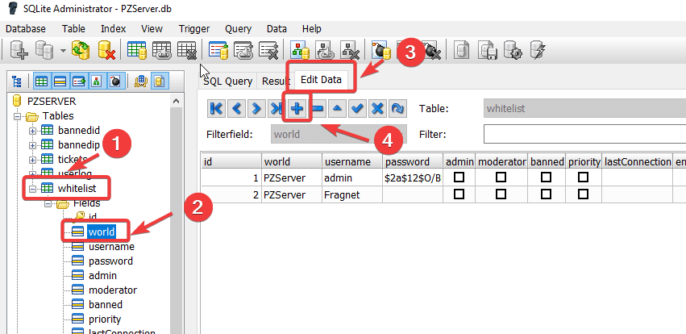

# Creating a whitelist for your Project Zomboid server

A whitelist makes your server private: only players with an account on the server can join, using their username and password. You turn off public access, then add an account for each player.

## Step 1: Turn off public access

1. Open the [Fragnet dashboard](VAR::PANEL_URL), go to **My servers** and select your Project Zomboid server.
2. Open the **Configuration** tab and select **General** in the list on the left.
3. In the **Startup** group, turn off **Public access**.
4. Select **Save** in the bar at the bottom of the page.
5. Restart the server: open ⋯ **More actions** at the top of the page and select **Restart**.

Now only players with an account can join. Players who already joined while the server was open have an account and can still join.

## Step 2: Add players

### With the server console

1. Make sure the server is running.
2. On the **Overview** tab, click in the **Enter a command…** field at the bottom of the **Console** card (see [Send a command](../../control-panel/basics.md#send-a-command)).
3. Type the following command, with the player's username and password, and press **Enter**:

   ```text
   adduser "username" "password"
   ```

4. Give the player their username and password. They enter them when they join the server.

### By editing the PZServer.db database

The server keeps its player accounts in `PZServer.db` in the `pzserver/db` folder. This is a binary file, so you download it, edit it on your computer and upload it again.

1. Stop the server with **Shut down**. The server writes to the database while it runs.
2. Open the **Files** tab and go to the `pzserver/db` folder.
3. Open the ⋯ menu of `PZServer.db` and select **Download**.
4. Download [SQLite Admin](http://sqliteadmin.orbmu2k.de/), a program for editing SQLite database files, and open `PZServer.db` with it.
5. Under **Tables**, select **whitelist**, expand it and select a field, for example **id**.
6. Open the **Edit Data** tab. To add a player, select the **+** button, then enter `PZServer` in the **world** column and the player's username and password in the **username** and **password** columns.

   

7. Close the database. Your changes are saved automatically.
8. In the dashboard, go back to the `pzserver/db` folder in the **Files** tab and upload the edited `PZServer.db` with **Upload**, or drag it onto the file list. It replaces the file on the server. See [Upload files](../../control-panel/file-manager.md#upload-files).
9. Start the server with **Start**.

:::info
The database file and the **world** value are named after the **Server Config Name** startup setting, which is `PZServer` by default. If you changed that setting, use your name instead.
:::
