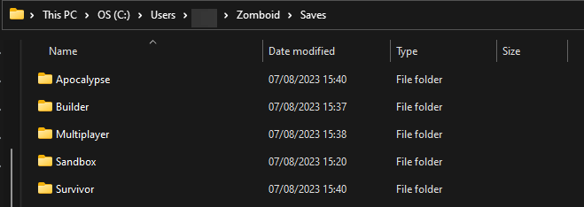
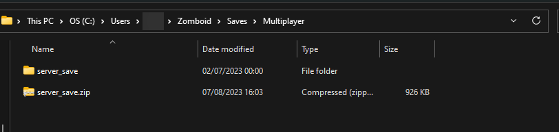
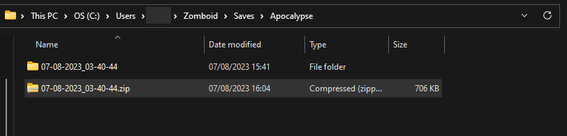

# Uploading your world to your Project Zomboid server

If you want to keep playing a world from your computer on your server, you can upload its save.

## Find your world on your computer

1. Go to `C:\Users\yourUsername\Zomboid\Saves`. There is a folder for each game mode you played in **Solo**, such as **Apocalypse**.

   

   Worlds you hosted for friends with **Host** in the main menu are in the **Multiplayer** folder. Worlds you played alone are in the folder of the game mode you chose when you created the world.

2. Make a `.zip` file of the world's save folder. Zip the folder itself, not just its contents.

   Example for a multiplayer world:

   

   Example for a singleplayer Apocalypse world:

   

## Upload the world and switch your server to it

The server loads the world in `pzserver/Saves/Multiplayer` whose folder name matches the **Server Config Name** startup setting. This is `PZServer` by default. You can see it on the **Configuration** tab under **General** > **Startup**.

1. Open the [Fragnet dashboard](VAR::PANEL_URL), go to **My servers** and select your Project Zomboid server.
2. If you want to keep the server's current world, make a [backup](../../control-panel/backups/index.md) first.
3. Stop the server with **Shut down**.
4. Open the **Files** tab and go to the `pzserver/Saves/Multiplayer` folder.
5. Upload your `.zip` file with **Upload**, or drag it onto the file list. Uploads over 100 MB should go through [SFTP](../../control-panel/file-manager.md#sftp-and-ftp-access).
6. Open the ⋯ menu of the uploaded file and select **Extract**. Your world's folder appears next to the server's current world folder. You can then delete the `.zip` file.
7. Move the current world out of the way: open the ⋯ menu of the `PZServer` folder and select **Rename**, and give it another name, such as `PZServer-old`. Or select **Delete** if you don't need it.
8. Open the ⋯ menu of your uploaded world's folder, select **Rename** and name it `PZServer` (or your **Server Config Name**).
9. Start the server with **Start**. It loads your uploaded world.

See [File and folder actions](../../control-panel/file-manager.md#file-and-folder-actions) for more on extracting and renaming.
