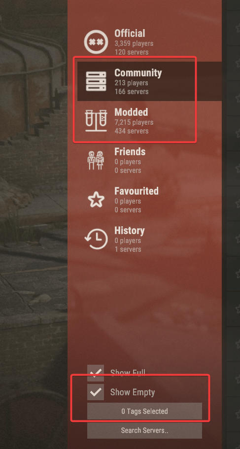
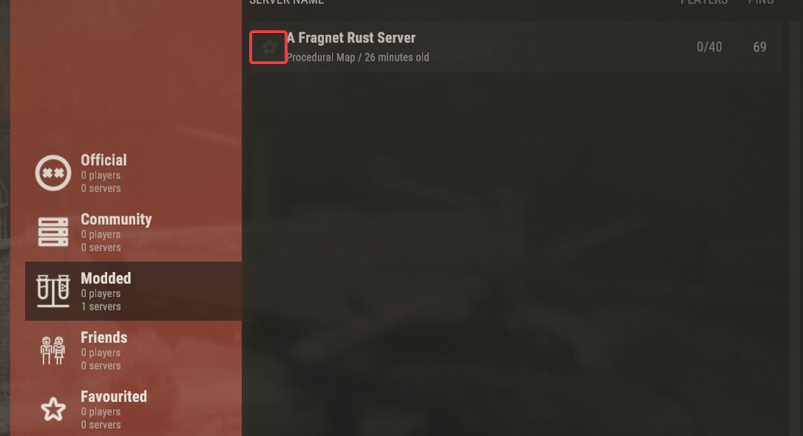
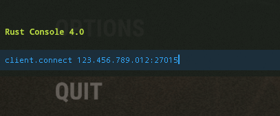
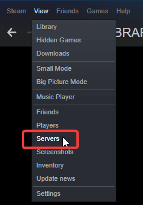

# Connecting to your Rust server

There are several ways to join your Rust server. All of them start in the [Fragnet dashboard](VAR::PANEL_URL).

## Before you connect

1. Open the [Fragnet dashboard](VAR::PANEL_URL), go to **My servers** and select your Rust server.
2. Check your server's address. It's the **Address** row of the **Server Details** card on the **Overview** tab. Select the copy button next to it to copy it. See [Server Details](../../control-panel/basics.md#server-details).
3. Give your server a name players can find. See [Change your server name](./change-server-name.md).
4. Start the server with **Start** at the top of the page. A Rust server takes a few minutes to start, longer the first time and on large maps. Wait until the **Console** shows `Server startup complete`.

## Via the in-game server browser

1. Open Rust and select **Play Game**. The server browser opens.
2. Select the **Community** tab. If your server runs Oxide or Carbon with plugins, select the **Modded** tab instead. You may need to tick **Show Empty** to see a server without players.

   

3. Type your server's name in **Search Servers..** and wait for it to appear. Select **Refresh** if it doesn't show up straight away; new servers can take a while to be listed.

   

4. Select the star next to your server to add it to the **Favourited** tab, so you can always find it there.

You can also filter the browser by tags. To set your server's tags, open the **Configuration** tab, select **General** and pick them under **Server browser** > **Tags**, for example **Monthly wipe**, **Vanilla** or **Europe**. They apply at the next restart. Read more about tags on the [Facepunch wiki](https://wiki.facepunch.com/rust/server-browser-tags).

## Via the in-game console

1. Open Rust. On the main menu, press **F1** to open the console.
2. Type `client.connect` followed by your server's address, for example:

   ```
   client.connect 123.456.789.012:27015
   ```

   

3. Press **Enter** to join. Press **F1** again to close the console.

## Via Steam favourites

1. Open Steam and select **View** > **Game Servers** (**Servers** in older Steam versions).

   

2. Go to the **Favorites** tab and select **Add a server**.
3. Enter your server's address and select **Add this address to favorites**. You can then join from the **Favorites** tab at any time. **Find games at this address...** shows the server straight away.
