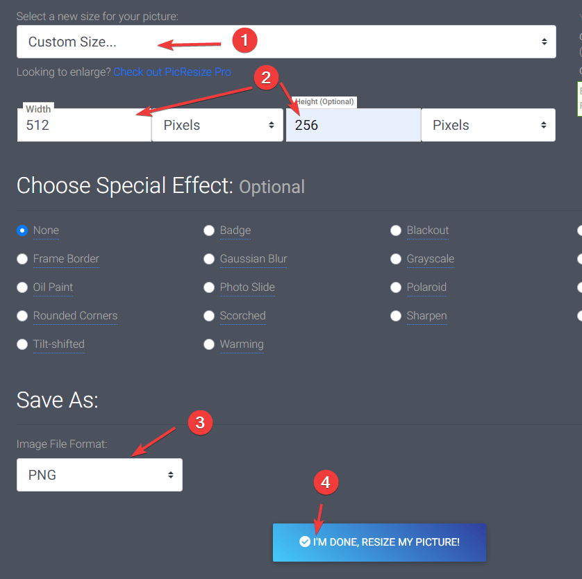
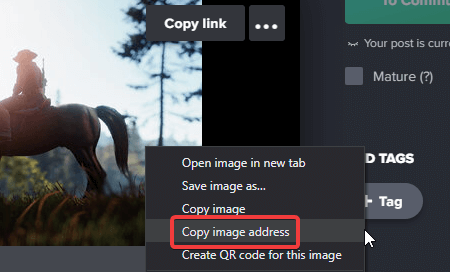

# How to add a header image and description to your Rust server

When players select your server in the Rust server browser, they see its header image and description. Use them to show what your server is about before anyone joins.

All of these settings are in the **Server** group of `server.cfg` on the **Configuration** tab:

| Setting | What it is |
| --- | --- |
| **Header image** | A link to a 512 × 256 PNG or JPG, shown above your description. |
| **Description** | The text players see when they open your server, up to 1,000 characters. |
| **Website** | The link on your server page in the browser, for example your Discord. |
| **Logo image** | A link to the logo shown in the server browser and the Rust+ app. |

## Header image

### Prepare the image

The image must be **512 × 256** pixels, in **.png** or **.jpg** format.

To resize an image, you can use an online tool such as [Picresize](https://picresize.com/). Upload the image, then under **Resize your picture** select **Custom Size...** and enter the size above. Make sure **Image File Format** is set to **PNG** or **JPG**, then select **I'm done, resize my picture!**.



### Upload the image

The image must be on a public image-hosting site. We recommend [Imgur](https://imgur.com/): upload the image with drag and drop, then right-click the image and select **Copy image address**. The link should end in `.png` or `.jpg`.



### Add the image to your server

1. Open the [Fragnet dashboard](VAR::PANEL_URL), go to **My servers** and select your Rust server.
2. Select the **Configuration** tab, then select `server.cfg` in the list on the left.
3. In the **Server** group, paste the image link into **Header image**.
4. Select **Save and restart**, or **Save** to apply it at the next restart. See [Change a setting](../../control-panel/configuration.md#in-a-game-config-file).

Your header image shows when players select your server in the Rust server browser.

## Server description

The description is the text players see when they select your server in the server browser. Common uses:

- Rules players should know about
- Plugins that change the game, such as gather rates
- Contact details, such as your Discord
- Your wipe schedule

### Add a description

1. On the **Configuration** tab, select `server.cfg`.
2. In the **Server** group, type your text into **Description**.
3. Select **Save and restart**, or **Save** to apply it at the next restart.

### New lines

To start a new line, write `\n` where the line should break. You don't need spaces around it. For example:

```
Welcome to our server!\nWipes every Thursday.\nDiscord: discord.gg/example
```

:::tip
**Header image** and **Description** may be tagged **Applied at start**. Then the dashboard keeps them in your startup settings and writes them into `server.cfg` at every start, so change them on the **Configuration** tab rather than in the file. A [scheduled wipe](./rust-wipe.md#schedule-a-wipe) also sets the description at every wipe.
:::
