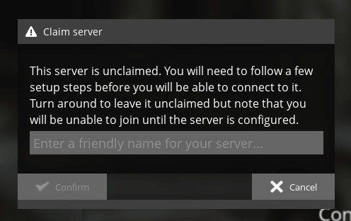
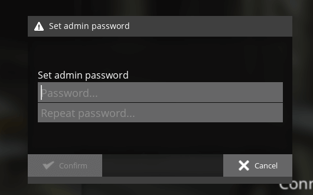
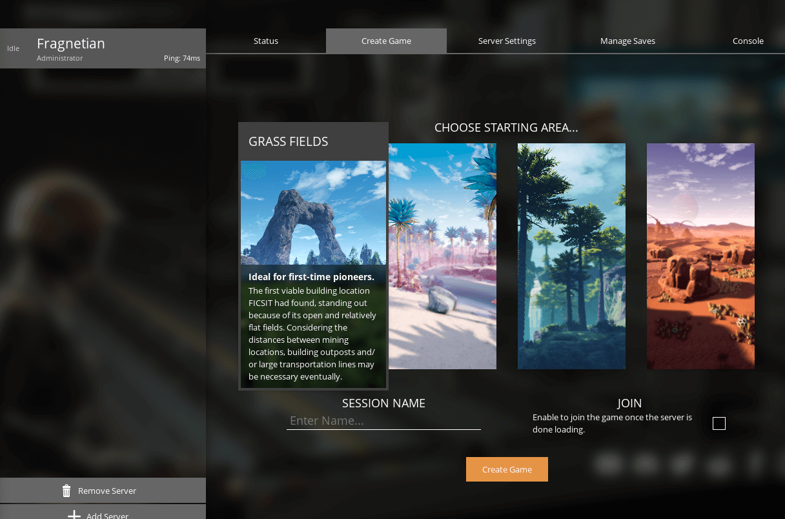
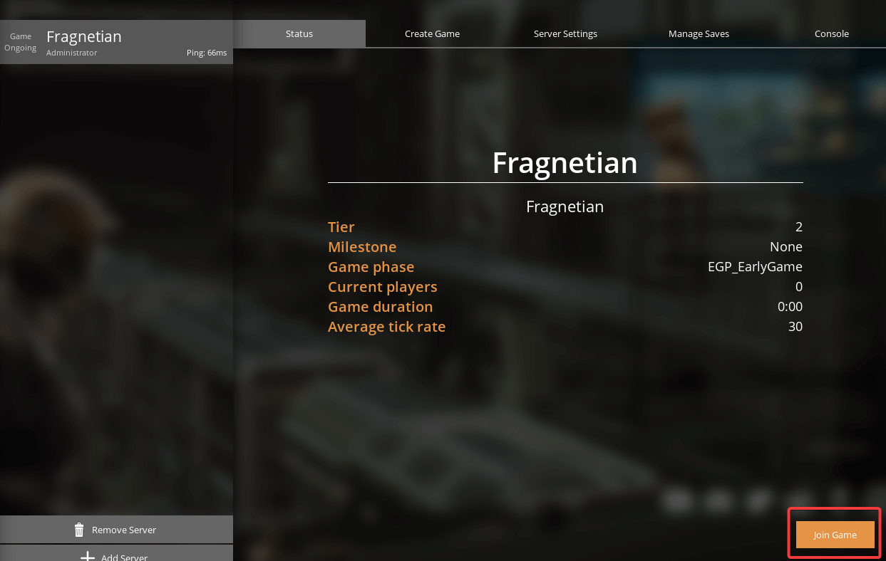

# How to claim and join your Satisfactory server

Satisfactory server always require you to claim the server in-game before connecting to it when you attempt to do so first time. This article will explain how to claim your server as well as connect to it afterwards. 

1\. Open the [Fragnet dashboard](VAR::PANEL_URL), go to **My servers** and select your Satisfactory server. Make sure the server is running.

2\. On the **Overview** tab, find **Address** in the **Server Details** card. It shows your server's IP address and port, for example `203.0.113.10:7777`. Select the copy button next to it to copy it. If the address shows a domain name, select **IP** to see the IP address instead. See [Server Details](../../control-panel/basics.md#server-details).

:::info
Since Satisfactory 1.0, the server uses this one port for joining. Older guides mention a separate query port (such as 15777); you don't need it any more.
:::

3\. Open your Satisfactory game and navigate to **Server Manager**. Click on the **Add Server** button. Enter the IP address (the part before the `:`) in the **Address** field and the port (the part after the `:`) in the **Port** field. Click on **Confirm**.

4\. If the server was succesfully added, you will see a new window that will ask you to input the name for the server to be claimed. 

5\. Set your **Admin Password** on the next window. 

6\. Once the server is claimed, you will need to create game on it before joining it. You can session name to any name that you would like and choose area to your preferences. 

7\. You can select **Status** tab and click on **Join Game** to connect to your Satisfactory server.

