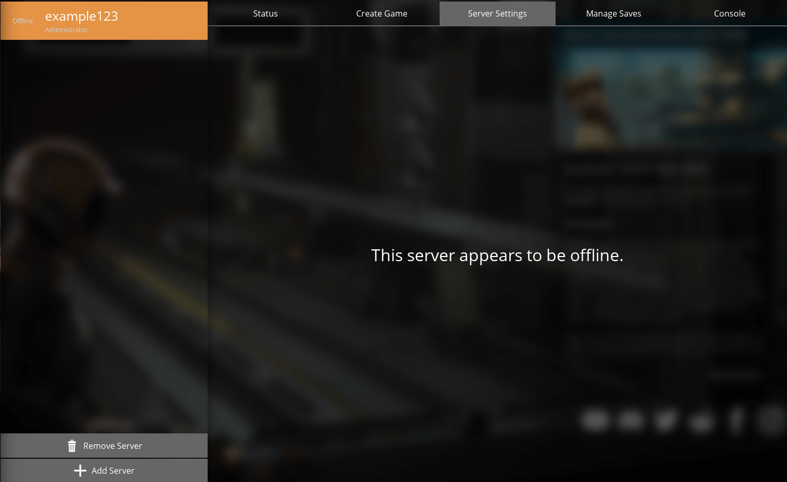
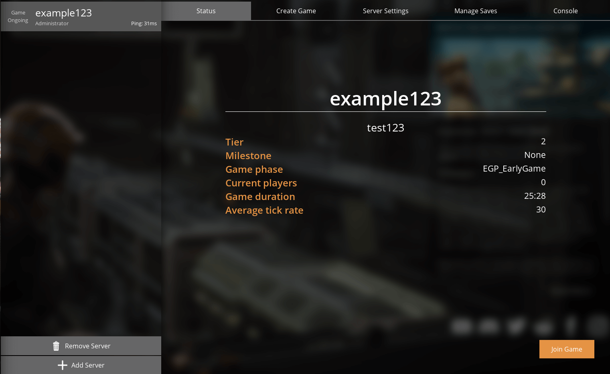

# "This server appears to be offline" message and how to solve it

This is a known issue in the game itself.

Staying on the main menu while your **Server Manager** is selected will have a chance to give you a `"This server appears to be offline"` even though the [Fragnet dashboard](VAR::PANEL_URL) shows the server as running. 

To make the server “online” in your game all that has to be done is to restart your game and the server will appear as running again.

If the server still appears offline after restarting the game, check the following:

- In the dashboard, the server's status is running and the console on the **Overview** tab shows no errors. See [Console](../../control-panel/basics.md#console).
- You added the server in **Server Manager** with the port from **Address** in the **Server Details** card, not an old query port. See [Claiming and joining your Satisfactory server](./claim-and-join-satisfactory-server.md).
